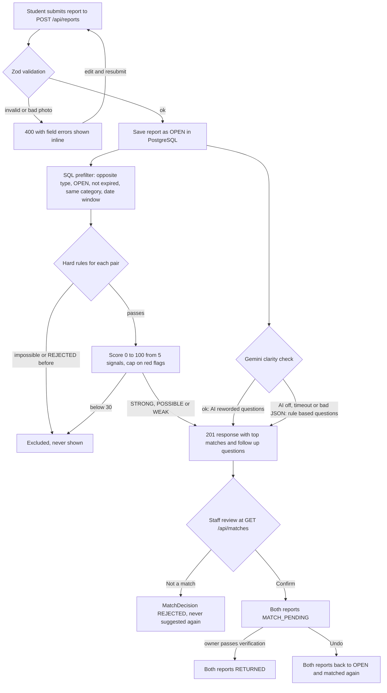

# The Lost & Found Matcher

A web app for a university Lost & Found desk. Students report items they **lost** or **found**, the app **suggests and explains** likely matches, and a **staff member verifies ownership** before anything is handed over. The app never decides on its own.

**Stack:** Next.js 14 + TypeScript + Tailwind · Express + Zod + Prisma · PostgreSQL 16 (Docker) · Vitest

## How to run

Needs **Node 20+** and **Docker** (running).

```bash
npm run setup   # install, start Postgres, run migrations, load demo data
npm run dev     # web on http://localhost:3000, API on http://localhost:4000
npm test        # 52 tests – no database, network or AI key needed
```

- **Student:** *+ Report an item*, or *My reports* with `amina@example.edu`.
- **Staff:** *Staff sign-in* with the `STAFF_PASSCODE` from `backend/.env` (`staff-demo` by default) → *Staff review*.
- **AI is optional:** set `GEMINI_API_KEY` in `backend/.env` to turn it on. Everything works without it.

## Screenshots

_See [`docs/screenshots`](docs/screenshots)._

---

## 1. Approach

Two strangers describe the same item **from memory, at different times, in different words**. I designed around six problems:

| Problem | Example | Solution |
|---|---|---|
| Different words | "AirPods case" vs "wireless earbud case" | Synonyms map to shared concepts |
| Subjective colours | "black" vs "dark", "navy" vs "blue" | Compare colour *families*; "Not sure" is neutral |
| Unsure time and place | "between 12 and 5, library or café" | Time windows, several places, neighbouring places get partial credit |
| Impossible pairs | found before it was lost; phone vs earbuds | Hard rules remove them before scoring |
| False claims | someone copies the public listing | Private detail and photo are staff-only, plus a verification question |
| Vague reports | "lost my bag somewhere" | Follow-up questions while typing |

The principles:
- **Structured where people can answer, free text where they can't.** Chips for item type, colour and places, always with a "Not sure" option.
- **Explainable rules decide.** Every point of a score comes with a sentence staff can read.
- **A human confirms.** Staff confirm or reject; the item is handed over only after the owner answers the verification question.
- **AI only helps fill in the form.** It's optional and never judges a match.

## 2. Assumptions

- One campus with about 13 named places and a "next to" map ([`shared/src/campus.ts`](shared/src/campus.ts)).
- A *found* report is one moment in time; a *lost* report is a time window.
- People can name at least the item type. Everything else can be "Not sure".
- Reports expire after 30 days without a match; staff can close any report.
- Students don't need accounts: they follow their reports by email or phone. Staff sign in.
- Photos are uploaded by the owner or finder when reporting. **The demo data uses free Unsplash stock photos as stand-ins** ([credits](backend/prisma/seed/photos/CREDITS.md)).

## 3. How the matching system works



1. **Validate and save.** Bad input returns field errors so the form can show them. Vague descriptions still save, but get follow-up questions.
2. **Pre-filter in SQL.** Only reports of the opposite type that are open, not expired, in the same category and in a sensible date window.
3. **Hard rules.** Drop impossible pairs: phone vs earbuds, found before it was lost, found 30+ days later, or already rejected by staff.
4. **Score 0–100.** Item type 25 · words 30 (synonyms count) · colour family 15 · place 15 (neighbours partial) · time 15.
5. **Cap red flags.** A colour or brand conflict caps it at *Possible*; found much later and far away caps it at *Weak*. Bands: **Strong ≥ 70**, **Possible 45–69**, **Weak 30–44**, hidden below 30.
6. **Staff decide.** Compare private details and photos, then *Confirm* or *Not a match*. *Mark returned* only works after the owner answers the verification question.

The weights live in one file: [`backend/src/matching/constants.ts`](backend/src/matching/constants.ts).

## 4. Major technical decisions

| Decision | Why |
|---|---|
| **Rules, not AI, decide matches** | It decides who gets an item, so it must be predictable, explainable and testable. |
| **Pure matching engine** | `backend/src/matching` has no Express or database code, so it's easy to test (52 tests). |
| **PostgreSQL** | Relational data with constraints: unique decisions, date checks, indexes for the pre-filter, and a two-report update in one transaction. |
| **Express API + Next.js UI** | A clear split: the engine and data don't depend on the UI framework. |
| **Shared package** | Categories, places and types are defined once and used by both apps. |
| **Staff login, anonymous students** | Private details and photos are protected by the server (signed httpOnly cookie, rate-limited passcode). Reporting stays quick. |
| **Photos verify, they don't score** | Similar items look alike in photos, and a stock photo proves nothing. Only a human can judge them. |
| **AI optional** | Gemini only suggests form fields and rewords questions. Strict JSON, 5 s timeout, and it falls back to rules on any failure. |

## 5. Intentionally not built

- **Image matching or AI in the score:** photos are for staff verification only.
- **Email/SMS notifications:** students check *My reports*.
- **Student accounts and editing a report after submitting.**
- **Individual staff accounts / SSO:** one shared staff passcode for the demo.
- **Admin screens** for the campus map and word lists: they're config files.

## 6. What I'd improve for a real product

- **University login** for staff (per person, with an audit log) and **email verification** for *My reports*.
- **Notifications** when a strong match appears or a match is confirmed.
- **Learn from staff decisions:** use confirmed and rejected pairs to tune weights and grow the synonym list.
- **Semantic text similarity** (embeddings with pgvector) as an extra signal next to the rules.
- **Cloud storage** for photos (private bucket, signed links), and a campus map with real distances.
- **Amharic support** in the UI and the word lists.

## AI usage

TODO: written by me

---

<details>
<summary><strong>Project layout</strong></summary>

```
backend/
  prisma/          schema, migrations, seed data (+ demo photos)
  src/
    config/        env, database
    routes/        one router per resource
    middlewares/   staff session check, upload, errors
    controllers/   HTTP in/out
    validators/    Zod schemas
    services/      business logic, transactions, optional AI
    models/        database queries (incl. SQL pre-filter)
    interfaces/    types
    utils/         errors, serializers, helpers
    matching/      the pure matching engine
  tests/           mirrors src/
frontend/
  app/             routes (thin pages)
  components/      ui, layout, home, reports, my-reports, report-form, staff
  services/        API client + one service per resource
  hooks/ context/ interfaces/ utils/ config/
shared/            categories, campus, colours, types
```

</details>

<details>
<summary><strong>API</strong></summary>

| Method | Path | Who |
|---|---|---|
| POST | `/api/reports` (JSON, or multipart with optional `photo`) | anyone |
| GET | `/api/reports` · `/api/reports/mine?contact=` · `/api/stats` | anyone |
| GET | `/api/reports/:id/photo` · `/api/matches` | staff |
| POST | `/api/matches/confirm` · `reject` · `undo` · `returned` · `/api/reports/:id/close` | staff |
| POST | `/api/auth/staff/login` · `/api/auth/logout` · GET `/api/auth/me` | anyone |
| POST | `/api/assist/extract` · `extract-photo` · `clarity` | anyone |

Errors are always `{ "error": { "message", "fields" } }`.

</details>
